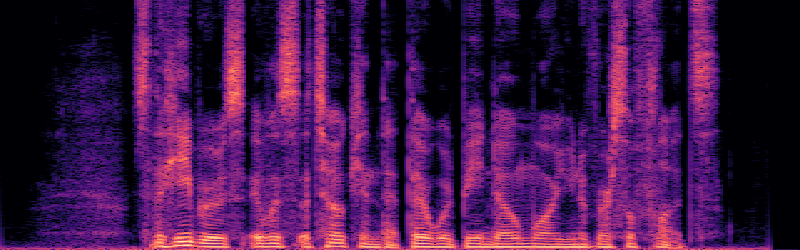
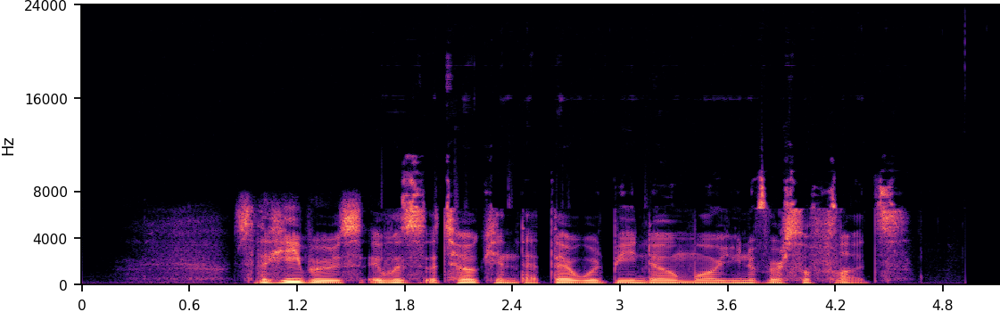
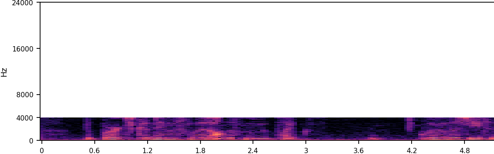
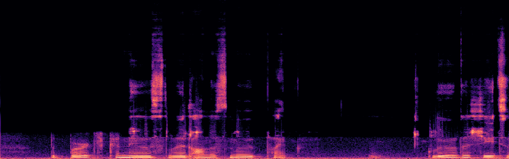
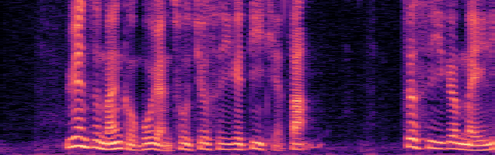
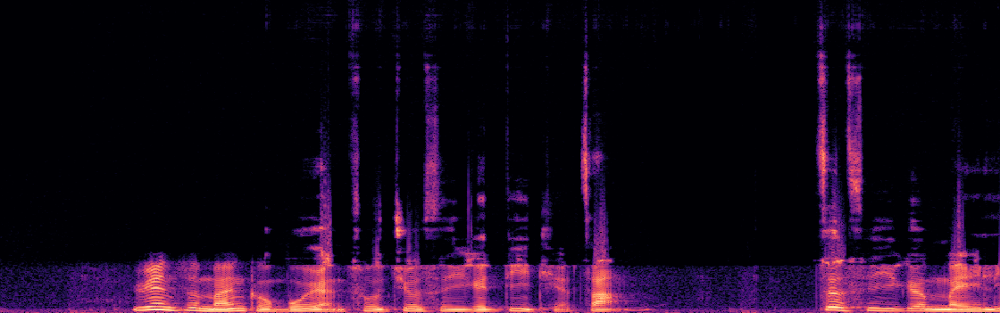

# AudioSR.AXERA

**AX650 / NPU3 语音超分：低采样率语音 → 48 kHz。完整链路 ONNX 拆分 + Pulsar2 混合量化，vocoder 板端相似度 0.9984，完整链路 vs PyTorch 0.9917。**

   [](https://huggingface.co/HY-2012/AudioSR.AXERA)

- HuggingFace（模型从这里下载）：<https://huggingface.co/HY-2012/AudioSR.AXERA>
- GitHub：<https://github.com/ZY-2012/AudioSR.AXERA>
- 上游：<https://github.com/haoheliu/versatile_audio_super_resolution>
- 输入：8 / 16 / 24 / 48 kHz 单声道或立体声 WAV；输出：48 kHz
- 5.12 s 输入，AudioSR DDIM-10；vocoder 拆成 9 个小模型以适配 AX650 内存和精度

> **AX650 板端实测说明**：AudioSR、LavaSR、FlowHigh 均已在 AX650N / NPU3 板端跑通。综合效果和速度最好的是 **LavaSR**：C++ 全链路 RTF ≈ 0.061（约 16× 实时），支持 8–48 kHz → 48 kHz 和降噪。**推荐优先使用 LavaSR。**
>
> **对比入口**
> GitHub: [LavaSR](https://github.com/ZY-2012/LavaSR.AXERA) · [FlowHigh](https://github.com/ZY-2012/FlowHigh.AXERA) · [AudioSR](https://github.com/ZY-2012/AudioSR.AXERA)
> HuggingFace: [LavaSR](https://huggingface.co/HY-2012/LavaSR.AXERA) · [FlowHigh](https://huggingface.co/HY-2012/FlowHigh.AXERA) · [AudioSR](https://huggingface.co/HY-2012/AudioSR.AXERA)

## 目录

- 快速开始
- 结果
- 工程结构
- 推理速度
- 模型
- 模型转换
- 数据来源
- License

## 快速开始（AX650 板端）

从 HuggingFace 下载整个仓库，或只下载 `models/`，放在包根目录旁：

```bash
# 模型目录结构
# AudioSR.AXERA/
# └── models/
#     ├── audiosr_unet.axmodel
#     ├── audiosr_vae_encoder_nhwc.axmodel
#     ├── audiosr_vae_decoder.axmodel
#     └── voc_*.axmodel

pip install -r requirements.txt

python python/demo.py \
  samples/listen/16k/speech_2_input_16k.wav \
  -o output_48k.wav

# C++（可选，需交叉编译）
bash cpp/build_ax650.sh
./cpp/bin/audiosr_ax650 models samples/listen/16k/speech_2_input_16k.wav output_48k_cpp.wav
```

输入 8 kHz / 16 kHz 均可；SDK 会重采样到 48 kHz，并按 AudioSR 的 5.12 s 窗口处理后送 NPU。

## 工程结构

```text
AudioSR.AXERA/
├── model_convert/       # ONNX 导出 → 拆分 → 校准数据 → Pulsar2 U16 量化
├── python/              # Python 板端推理 SDK（axengine）
├── cpp/                 # C++ 板端推理源码 + 交叉编译脚本
├── models/              # 仅 README，量化模型从 HuggingFace 下载
├── samples/             # 中英文示例输入
└── requirements.txt
```

## 结果

### English 16 kHz

| 输入 | AudioSR 输出 |
|---|---|
| [▶ 16k input](samples/listen/16k/speech_2_input_16k.wav)<br> | [▶ 48k output](samples/listen/output/speech_2_output_48k.wav)<br> |

### English 8 kHz

| 输入 | AudioSR 输出 |
|---|---|
| [▶ 8k input](samples/listen/8k/OSR_us_000_0010_input_8k.wav)<br> | [▶ 48k output](samples/listen/output/OSR_us_000_0010_output_48k.wav)<br> |

### 中文 8 kHz

| 输入 | AudioSR 输出 |
|---|---|
| [▶ 8k input](samples/listen/8k/OSR_cn_000_0072_input_8k.wav)<br> | [▶ 48k output](samples/listen/output/OSR_cn_000_0072_output_48k.wav)<br> |

### 精度

| 模块 / 链路 | 板端 vs ONNX/PyTorch |
|---|---:|
| VAE encoder（NHWC） | 0.99975 |
| UNet | 0.99989 |
| VAE decoder | 0.99999 |
| vocoder 9-model chain | **0.99838** |
| full AudioSR chain | **0.99169** |

## 推理速度

5.12 s 输入、DDIM-10、AX650 NPU3：

```text
Python SDK: 约 20–22 s / 5.12 s，RTF ≈ 4.0–4.3
C++:        约 7.3 s / 5.12 s，RTF ≈ 1.43
```

C++ 全链路已实现：WAV → 重采样 → STFT/log-mel → VAE encoder → DDIM-10 UNet → decoder → 拆分 vocoder → 后处理。构建方式见 [`cpp/README.md`](cpp/README.md)。

## 模型

模型不放进 GitHub，统一从 HuggingFace 下载：

- `audiosr_unet.axmodel`：273 MB
- `audiosr_vae_encoder_nhwc.axmodel`：102 MB
- `audiosr_vae_decoder.axmodel`：143 MB
- `voc_pre_fp32.axmodel`：11 MB
- `voc_up0a_mix.axmodel`：55 MB
- `voc_up0b_mix.axmodel`：202 MB
- `voc_up1a_mix.axmodel`：12 MB
- `voc_up1b_mix.axmodel`：52 MB
- `voc_split_nhwc_up2_mix.axmodel`：17 MB
- `voc_split_nhwc_up3_mix.axmodel`：7.7 MB
- `voc_split_nhwc_up4_mix.axmodel`：5.8 MB
- `voc_split_nhwc_post_fp32.axmodel`：99 KB
- `mel_filters_256x1025.bin`：C++ mel 滤波器

详见 [`models/README.md`](models/README.md)。

## 模型转换

```bash
# 1. 上游 AudioSR 代码 / checkpoint
# 2. 导出 VAE encoder / UNet / decoder / vocoder 子图
# 3. 校准数据
# 4. Pulsar2 8.0 量化
PULSAR2_IMAGE=docker-registry.aitsw.axera-tech.com/pulsar2:8.0 \
  bash model_convert/compile.sh voc_pre_fp32 voc_up0a_mix ...
```

具体命令、BF16/U16/S8 配置和各阶段校准见 [`model_convert/README.md`](model_convert/README.md)。

## 数据来源

- 上游 AudioSR：<https://github.com/haoheliu/versatile_audio_super_resolution>
- 示例英文 / 中文语音：Open Speech Repository、公开 16 kHz 人声样例
- 示例输出由本项目 AX650 Python SDK 生成

## License

AudioSR 上游代码与模型 checkpoint 遵循其原始许可证；本仓库的转换脚本和 SDK 以 Apache-2.0 提供。模型权重请遵循上游许可证。
